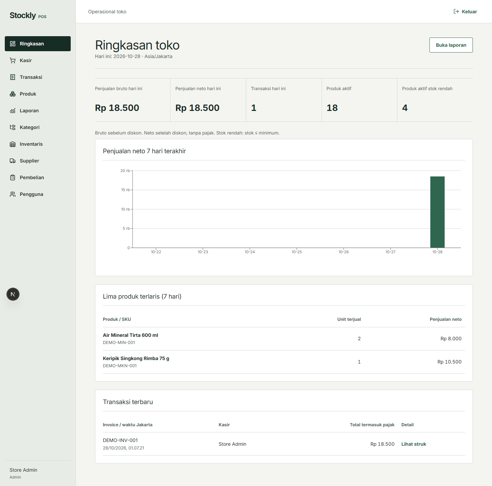
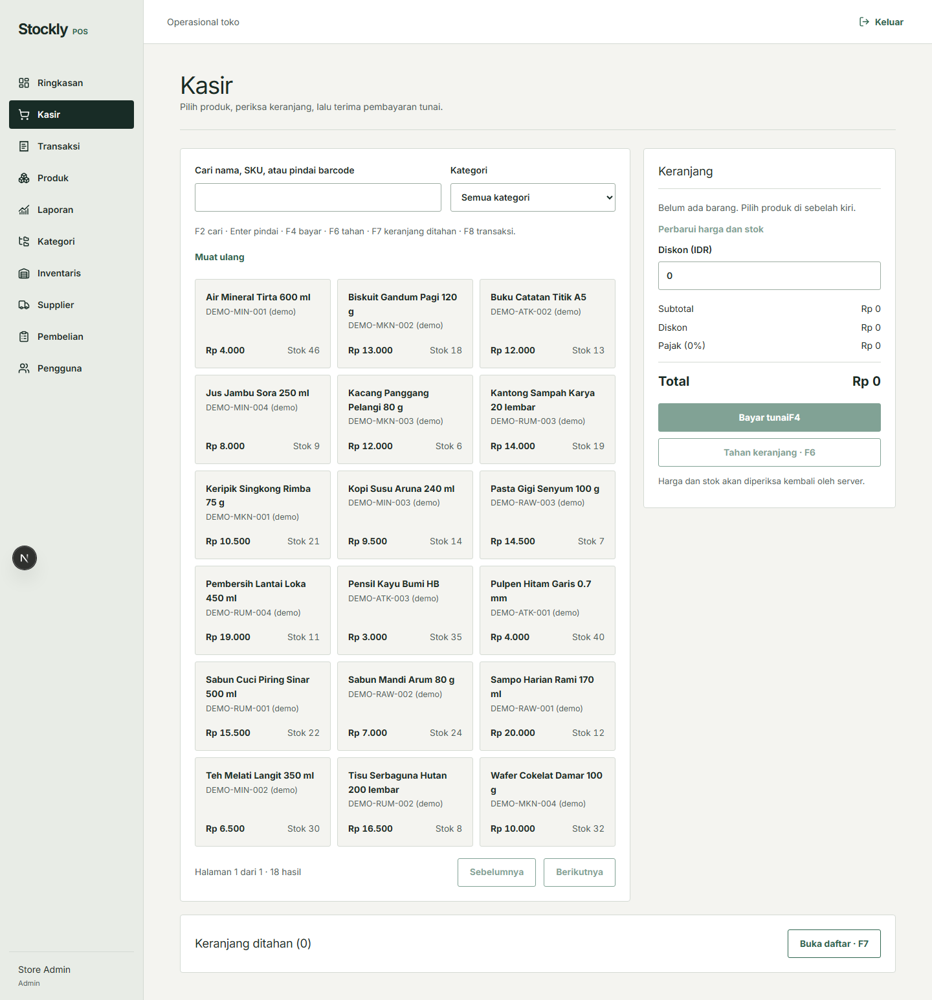

# Stockly POS

A single-store point-of-sale and inventory system for Indonesian Rupiah (IDR). Cashiers need fast, reliable checkout while store owners need traceable stock changes, supplier receiving, and sales visibility. Stockly keeps those operations in one PostgreSQL-backed application.

**Currently available for local development and demonstration. Public deployment is planned for a future release.** This is not a production-security certification or a hosted demo.

## What it does

- **Cashier:** search or scan a USB keyboard-emulation barcode, edit a cart, hold and resume it, accept cash, print an 80mm receipt, and view own transactions.
- **Admin:** manage categories, products, inventory adjustments, cashiers, suppliers, and purchase orders; view store-wide transactions, low-stock warnings, dashboard charts, and export four-sheet Excel reports.
- **Integrity:** server-calculated integer-IDR totals, transactional stock movements, price/cost snapshots, checkout idempotency, one-time PO receiving, and held-cart completion guards. See [engineering decisions](docs/DECISIONS.md) and [Phase 8 audit](docs/PHASE8_VERIFICATION.md).

## Screenshots

Actual localhost views captured from **fictional seeded data**. The Next.js development indicator may appear in some captures.

| Dashboard | Cashier POS |
| --- | --- |
|  |  |

| Catalog and inventory | Supplier and purchase orders | Sales reports |
| --- | --- | --- |
| [Products](docs/screenshots/products.png) · [Inventory](docs/screenshots/inventory.png) | [Suppliers](docs/screenshots/suppliers.png) · [Purchase orders](docs/screenshots/purchase-orders.png) | [Analytics and Excel export](docs/screenshots/sales-reports.png) |

Regenerate on a **dedicated demo-only database** with `npm run screenshots:local` while `npm run dev` is running. The script refuses databases containing non-demo records or additional users.

## Technology and architecture

Next.js 15 App Router, React 19, JavaScript/JSX, Tailwind CSS, React Hook Form, Zod, Recharts, Lucide React, and Inter. A separate Node.js/Express REST API uses Prisma, PostgreSQL 16, JWT in HttpOnly cookies, bcryptjs, Helmet, CORS, CSRF tokens, and ExcelJS. Vitest/Supertest cover the API and PostgreSQL; Playwright covers browser workflows. npm workspaces run the two apps together.

```text
Browser (http://localhost:3000)
    └─ Next.js UI ── credentials + CSRF ──> Express REST API (http://localhost:4000)
                                          └─ Prisma ──> PostgreSQL (localhost:5432)
```

The API owns authorization, validation, IDR calculations, checkout, stock transactions, purchasing, and reporting. The browser never receives the JWT value. Product/category/stock-movement, sale/item/payment, supplier/purchase-order/item, and held-cart/item tables have foreign keys and constraints; migrations live in `prisma/migrations/`. One store is represented by `StoreSetting`.

| Path | Purpose |
| --- | --- |
| `apps/web/app`, `apps/web/components` | Next.js pages and operational UI |
| `apps/api/src`, `apps/api/test` | Express routes and unit/integration tests |
| `prisma/`, `shared/` | PostgreSQL schema, local seed, integer-money/reporting helpers |
| `tests/e2e/`, `docs/` | Browser tests, decisions, verification, demo and portfolio materials |
| `scripts/capture-local-screenshots.js` | Demo-only screenshot capture |

## Requirements and PostgreSQL

- Node.js **20+**, npm, and PostgreSQL **16** locally, or Docker Desktop with Compose **for the database only**.
- A free `3000` (web), `4000` (API), and `5432` (database). Playwright uses separate `3100`/`4100` so it can run beside the dev servers.
- Chromium for browser tests/screenshots: `npx playwright install chromium`.

**Option A, existing local PostgreSQL:** create a local `stockly` database and login role, grant that role migration/DDL rights on the database/schema, and put its matching URL in `.env`. For example, in `psql` as a local PostgreSQL administrator:

```sql
CREATE ROLE stockly LOGIN PASSWORD '<your-local-database-password>';
CREATE DATABASE stockly OWNER stockly;
```

**Option B, optional Compose database:** set `POSTGRES_PASSWORD` in the ignored `.env` file, then `docker compose up -d db`. `compose.yaml` binds PostgreSQL to `127.0.0.1:5432`; it does **not** deploy the web/API. Existing Compose volumes retain their original password; changing `.env` alone will not rotate a previously initialized database password.

## Install and run on Windows

Open **PowerShell or the VS Code PowerShell terminal** in the repository root:

```powershell
Copy-Item .env.example .env
# Edit .env privately: set matching PostgreSQL credentials, a random JWT_SECRET,
# and a unique ADMIN_EMAIL / ADMIN_PASSWORD. Never commit .env.
npm ci
docker compose up -d db   # optional: skip when local PostgreSQL is already running
npm run db:generate
npm run db:migrate
npm run db:seed
npm run dev
```

Open `http://localhost:3000`; the API listens on `http://localhost:4000`. `npm run dev` starts both with `concurrently`; `npm run dev:web` and `npm run dev:api` are available for separate terminals. On Windows Bash harnesses missing System32 in PATH, prefix the command with `PATH="/c/Windows/System32:$PATH"`; normal PowerShell has `cmd.exe` on PATH.

`.env.example` documents `DATABASE_URL`, `POSTGRES_PASSWORD` (Compose only), `JWT_SECRET` (32+ random characters), `PORT=4000`, `WEB_ORIGIN=http://localhost:3000`, `NEXT_PUBLIC_API_URL=http://localhost:4000`, `COOKIE_SAME_SITE=lax`, and initial admin/store fields. The browser needs only `NEXT_PUBLIC_API_URL`; never put a private password or JWT secret in `NEXT_PUBLIC_*`. Cookies are HttpOnly for the JWT and not Secure over local HTTP; HTTPS production cookies require a separate deployment review. The readable CSRF cookie supplies a signed header for mutations. API CORS accepts the exact `WEB_ORIGIN`.

`npm run db:migrate` applies **development** migrations to PostgreSQL; `npx prisma migrate status` checks the six existing migrations. `npm run db:seed` creates the initial admin only if its email is absent, never resets existing credentials/settings, and inserts clearly labeled fictional categories/products, stock movements, one supplier, a received PO (`DEMO-PO-001`), an ordered but unreceived PO (`DEMO-PO-002`), and one cash sale only outside production. Re-running skips existing demo identities and does not receive/deduct twice. Demo sale totals use the current store tax setting; if demo goods are inactive/out of stock, it skips the sale rather than altering other data. Set the admin password yourself in `.env`; the project publishes **no fixed demo password**. Create a Cashier on `/users` as Admin and set a separate local password for the walkthrough.

## Tests and local checks

```powershell
npm test                  # Vitest + real-PostgreSQL API/integration tests
npm run lint
npm run build             # Next.js production compilation, not deployment
npm run test:e2e          # Playwright; runs its own 3100/4100 servers and test fixtures
npx prisma migrate status
```

Run tests against a disposable **local development** database, never real store data: Playwright creates and deletes fixture records. The latest verified results and environment caveats are in [docs/PROGRESS.md](docs/PROGRESS.md) and [docs/HANDOFF.md](docs/HANDOFF.md).

## REST API at a glance

All routes start with `/api`. `auth/csrf`, `auth/login`, `auth/me`, and `auth/logout` handle sessions. `users`, `categories`, `products`, and `inventory/adjustments` handle access and catalog/stock. `sales`, `sales/:id/receipt`, and `held-carts` cover checkout/history/recovery. `suppliers` and `purchases/:id/receive` handle procurement. `reports/overview`, `reports/sales`, `reports/products`, and `reports/export` drive dashboard and XLSX. Admin mutations and store-wide reports are backend-gated; cashiers access only their own history/held carts. Mutations require CSRF headers. See route definitions in `apps/api/src/` for exact payloads.

## Demo, challenges, and limits

Follow the [localhost demo walkthrough](docs/DEMO_GUIDE.md) from Admin dashboard through product/stock, supplier receiving, Cashier barcode/hold/checkout/receipt, then sales analytics and Excel. [Portfolio notes](docs/PORTFOLIO.md) summarize the engineering work.

Key challenges include preventing last-unit overselling, preserving historical prices and costs, handling lost checkout/receiving responses without duplicate writes, and revalidating held carts without reserving stock. Limits: one store, cash only, no partial receiving or payment gateway, no camera scanner, browser printing requires an actual printer for physical verification, and initial hold/draft/adjustment creation lacks a retry identity. Reports use Asia/Jakarta days while transaction-history filters use UTC days. The in-memory rate limiter is not shared across replicas; local verification is not a penetration test or proof of production readiness. Future work, **only if separately authorized**, includes deployment hardening, load/accessibility testing, backup/restore, and scale-driven pagination/index changes.

### Troubleshooting

- **Database unavailable:** verify PostgreSQL/Compose is running on `5432`, `DATABASE_URL` matches its role/password/database, and `npx prisma migrate status` connects. Do not delete an existing volume to fix a password mismatch; use the existing database credentials or change the role password deliberately.
- **API refuses to start:** supply a non-placeholder `JWT_SECRET` of 32+ characters and exact `WEB_ORIGIN`. Use `COOKIE_SAME_SITE=lax` for local HTTP, not `none`.
- **Login/CSRF/CORS fails:** use `localhost` consistently (not mixed with `127.0.0.1`), verify `NEXT_PUBLIC_API_URL=http://localhost:4000` and `WEB_ORIGIN=http://localhost:3000`, restart Next.js after changing public variables, and check browser cookies/network responses.
- **Port conflict:** stop the specific process occupying `3000`, `4000`, or `5432` before starting; Playwright additionally needs `3100`/`4100`.
- **Prisma warning:** Prisma 6 warns that the `package.json#prisma` seed configuration will be removed in Prisma 7; the current Prisma 6 workflow remains functional. Run `npm run db:generate` after a schema/client mismatch.
